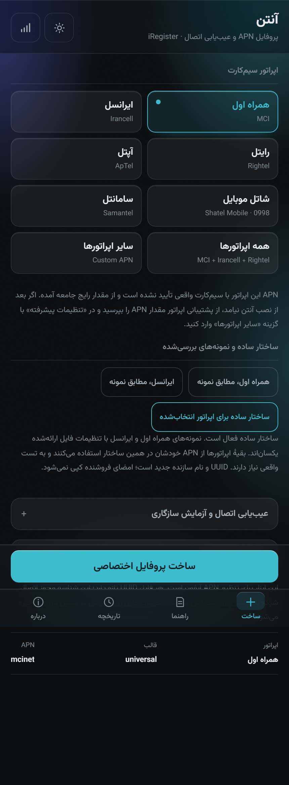
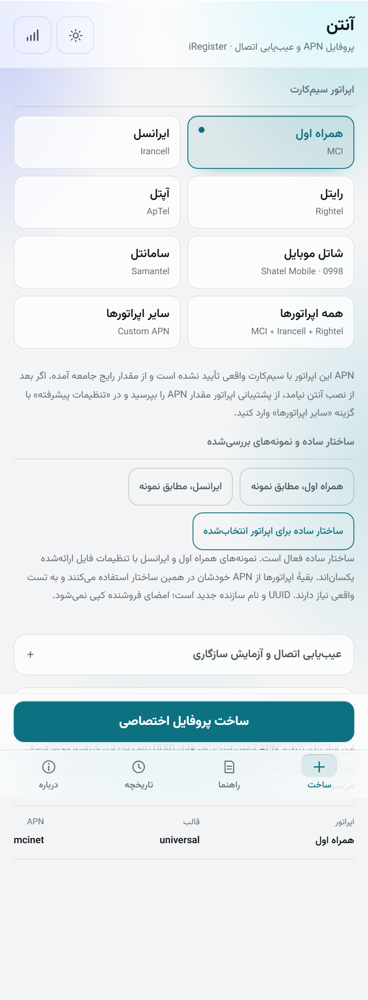
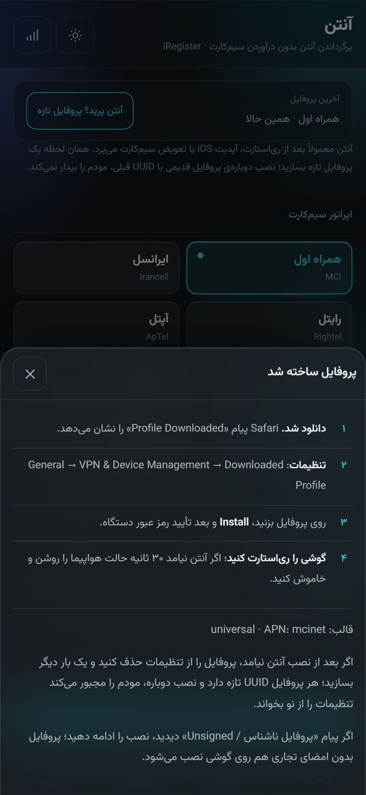
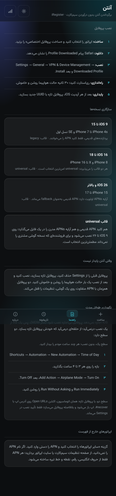
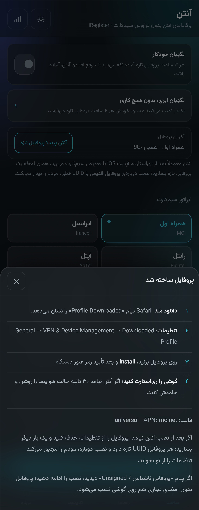
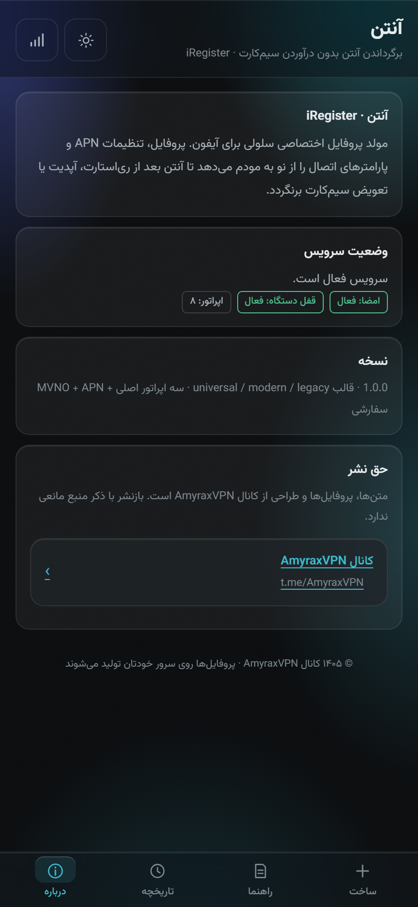

# آنتن، iRegister

مولد پروفایل اختصاصی سلولی آیفون برای برگرداندن آنتن. وب‌اپ فارسی RTL، قابل نصب روی صفحه اصلی (PWA)، بدون هیچ dependency.

متن، پروفایل‌ها و طراحی از کانال [AmyraxVPN](https://t.me/AmyraxVPN) است؛ بازنشر با ذکر منبع آزاد است.

جهت طراحی، پالت، و دلیل هر تصمیم بصری در [DESIGN.md](DESIGN.md) ثبت شده است. برای ادامه‌دادن پروژه با ایجنت دیگر، [HANDOFF.md](HANDOFF.md) را بده.

فونت وزیرمتن به‌صورت self-hosted در `public/fonts/Vazirmatn.woff2` قرار دارد (یک فایل variable، وزن ۱۰۰ تا ۹۰۰). هیچ درخواستی به گوگل فونت زده نمی‌شود و سرویس‌ورکر فونت را برای حالت آفلاین کش می‌کند. تمام بخش‌های اپ، از جمله APN و پیش‌نمایش XML، با همین فونت رندر می‌شوند.



<details>
<summary>بقیه نماها</summary>

حالت روشن:



شیت نصب بعد از ساخت:



راهنمای نصب:



کارت بازیابی و حالت نگهبان:



درباره و حق نشر:



</details>

## چی کار می‌کند

آیفون بعد از ری‌استارت، آپدیت iOS یا تعویض سیم‌کارت، پارامترهای شبکه سلولی را دوباره از اپراتور نمی‌خواند و آنتن می‌افتد. این ابزار یک فایل `.mobileconfig` می‌سازد که payload سلولی (`com.apple.cellular`) را روی دستگاه نصب می‌کند تا مودم APN و پارامترهای اتصال را از نو بخواند و به شبکه attach کند.

هر پروفایل با UUID تازه ساخته می‌شود. این نکته کلیدی است: iOS پروفایلی را که با UUID یکسان دوباره نصب شود، به‌عنوان همان تنظیمات قبلی می‌شناسد و چیزی را از نو نمی‌خواند. UUID جدید نصب را به یک رخداد تازه تبدیل می‌کند.

سه قالب خروجی:

| قالب | نسخه‌ها | محتوا |
|---|---|---|
| `universal` | iOS 9 → 26 | کلید `APN` قدیمی + آرایه `APNs` مدرن در یک فایل |
| `modern` | iOS 16 → 26 | فقط آرایه `APNs` (DDNA) |
| `legacy` | iOS 9 → 15 | فقط کلید `APN` تکی |

## بازیابی بعد از افتادن آنتن

آنتن بعد از رخدادهایی مثل ری‌استارت، آپدیت iOS یا تعویض سیم‌کارت می‌افتد و عمر ثابتی ندارد. برای همین اپ یک مسیر بازیابی دارد:

- بالای صفحه‌ی ساخت، کارت «آخرین پروفایل» با نام اپراتور و عمر پروفایل نشان داده می‌شود و یک دکمه دارد: «آنتن پرید؟ پروفایل تازه».
- همان دکمه در هر ردیف تاریخچه هم هست.
- لینک `#recover` برای Shortcuts: اپ را باز می‌کند و بلافاصله برای همان اپراتور پروفایل تازه می‌سازد. برای اجرای خودکار بعد از هر ری‌استارت در راهنما توضیح داده شده است.
- نصب دوباره‌ی پروفایل قبلی کافی نیست، چون UUID همان است و iOS آن را تنظیمات تکراری می‌بیند. هر بار باید پروفایل تازه ساخته شود.

### نگه‌داشتن آنتن برای مدت طولانی

هیچ نصب تکی، یک ماه دوام نمی‌آورد؛ عمر آنتن را رخدادهای شبکه تعیین می‌کنند. چیزی که دوام می‌سازد، حلقه است:

- «نگهبان خودکار» را روشن کنید: اپ هر ۳ ساعت یک پروفایل تازه آماده نگه می‌دارد و با قطع شدن لینک، همان لحظه یکی می‌سازد. کاربر فقط تأیید نصب می‌کند.
- پروفایل با `PayloadRemovalDisallowed` ساخته می‌شود تا بی‌تأیید حذف نشود.
- اپ با ضربان `/api/ping` هر ۶۰ ثانیه اتصال را می‌پاید؛ سه شکست پشت‌سرهم، بنر «اتصال قطع است» را نشان می‌دهد.
- یک اتوماسیون Shortcuts هر ۳ تا ۴ ساعت `#recover` را باز می‌کند تا اپ بیدار شود و پروفایل تازه بسازد.

تنها کار دستی در حالت نگهبان محلی، تأیید پنجره‌ی نصب است. برای حذف کامل حتی همان یک تأیید، مسیر «نگهبان ابری» هست.

### نگهبان ابری، یک نصب و بعد هیچ

این مسیر MDM است و برای «یک ماه بدون برگشتن» طراحی شده:

- یک‌بار پروفایل ثبت را نصب می‌کنید و تمام. دستگاه از آن به بعد خودش هر چند وقت یک بار از سرور می‌پرسد کاری دارد یا نه.
- سرور در هر تماس، اگر آخرین پروفایل کفایت کرده باشد کاری نمی‌کند؛ وگرنه یک پروفایل سلولی تازه با UUID جدید می‌سازد، امضا می‌کند و به‌صورت فرمان `InstallProfile` می‌فرستد. iOS آن را بدون تأیید نصب می‌کند.
- بازه‌ی پیش‌فرض ارسال ۶ ساعت است (`MDM_PUSH_EVERY_MS`) و تأخیر واقعی به بازه‌ی پرسش خود iOS بستگی دارد که معمولاً چند ده دقیقه است.

پیش‌نیازهایش، تا انتظار درست باشد:

- سرور باید از بیرون قابل دسترس و روی HTTPS باشد؛ `PUBLIC_BASE_URL` را ست کنید.
- گواهی ریشه‌ی محلی داخل همان پروفایل ثبت می‌شود و با `ServerCertificateAnchorUUID` لنگر می‌شود، وگرنه گوشی زنجیره‌ی TLS را قبول نمی‌کند.
- دستگاه پس از نصب، «مدیریت‌شده» نشان می‌دهد و این طبیعی است.
- بدون گواهی APNs، ارسال با همان تماس دوره‌ای دستگاه انجام می‌شود، نه پوش فوری؛ پس فقط برای بی‌تأخیرترین حالت به گواهی اپل نیاز است.


## اجرا

```bash
node server.js
# http://localhost:8787
```

بدون `npm install`. تنها چیزی که لازم است Node 20+ است.

### متغیرهای محیطی

| متغیر | پیش‌فرض | کار |
|---|---|---|
| `PORT` | `8787` | پورت |
| `HOST` | `0.0.0.0` | interface |
| `PUBLIC_BASE_URL` | خالی | آدرس عمومی برای ساخت لینک دانلود (پشت reverse proxy) |
| `TOKEN_TTL_MIN` | `10080` | عمر لینک دانلود (۷ روز) |
| `BIND_DEVICE` | `1` | قفل کردن هر پروفایل به یک دستگاه |
| `RATE_MAX` | `40` | سقف ساخت پروفایل در هر دقیقه |
| `ADMIN_KEY` | خالی | فعال‌سازی `/api/admin/*` |
| `SIGN_CERT` / `SIGN_KEY` / `SIGN_CHAIN` | `certs/*` | گواهی امضای CMS |
| `OPENSSL_BIN` | خودکار | مسیر openssl |

## امضای پروفایل

```bash
npm run cert          # CA + leaf محلی در certs/
node server.js        # امضا خودکار فعال می‌شود
```

پروفایل بدون امضا هم نصب می‌شود؛ iOS فقط هشدار «Unsigned» نشان می‌دهد. برای حذف کامل هشدار، گواهی تجاری (S/MIME) بخرید و با `SIGN_CERT`/`SIGN_KEY` وصل کنید.

## ساختار

```
server.js              HTTP + مسیرها + توکن + قفل دستگاه
shared/catalog.js      دیتای اپراتورها، قالب‌ها، ماتریس iOS
shared/profile.js      سازنده پروفایل (هم در Node هم در مرورگر)
src/ledger.js          ثبت پروفایل‌ها روی فایل JSON
src/sign.js            امضای CMS با openssl
public/                اپ PWA فارسی
scripts/make-cert.mjs  ساخت CA و گواهی امضا
```

## API

| متد | مسیر | کار |
|---|---|---|
| `GET` | `/api/health` | وضعیت سرویس و self-test پروفایل |
| `GET` | `/api/catalog` | اپراتورها، قالب‌ها، ماتریس iOS |
| `POST` | `/api/profile` | ساخت پروفایل و گرفتن لینک دانلود |
| `GET` | `/p/:id.mobileconfig?t=…` | دانلود پروفایل (یک دستگاه) |
| `GET` | `/api/profile/:id/preview?t=…` | پیش‌نمایش XML |
| `POST` | `/api/profile/:id/claim` | بررسی اتصال پروفایل به دستگاه |
| `GET` | `/api/admin/stats` | آمار (نیاز به `x-admin-key`) |
| `POST` | `/api/admin/rebind` | آزاد کردن قفل دستگاه |

نمونه:

```bash
curl -s localhost:8787/api/profile -H 'content-type: application/json' \
  -d '{"operatorId":"mci","format":"universal"}' | jq
```

## قفل «یک گوشی»

لینک دانلود یک توکن HMAC دارد و اولین درخواست، یک کوکی `ir_dev` روی دستگاه می‌نشاند. درخواست بعدی از دستگاه دیگر `409` می‌گیرد. برای توزیع انبوه (فروش) `BIND_DEVICE=0` بگذارید یا از `ADMIN_KEY` و `/api/admin/rebind` استفاده کنید.

## انتشار روی گیت‌هاب

برای اینکه کاربر فقط یک لینک را باز کند و پروفایل خودش را بسازد، نسخه‌ی استاتیک کافی است: پروفایل در خود مرورگر ساخته می‌شود و هیچ سروری لازم نیست.

```bash
node scripts/build-site.mjs       # خروجی در site/
node scripts/check-static.mjs     # گیت: بدون هیچ درخواست /api، پروفایل درست ساخته می‌شود
```

گردش کار:

1. روی گیت‌هاب یک مخزن خالی بساز (بدون README).
2. همین پوشه را وصل و push کن:

```bash
git remote add origin https://github.com/<user>/<repo>.git
git push -u origin main
```

3. در Settings → Pages، منبع را روی «GitHub Actions» بگذار.
4. اکشن `pages` خودش `site/` را می‌سازد و منتشر می‌کند؛ آدرس نهایی می‌شود `https://<user>.github.io/<repo>/`.

نسخه‌ی استاتیک از نسخه‌ی سروری سبک‌تر است و این تفاوت‌ها را دارد: بدون دفترکل و آمار، بدون امضای تجاری (iOS برچسب Unsigned می‌دهد)، بدون قفل یک گوشی، و بدون نگهبان ابری. نگهبان محلی روی همان صفحه هم کار می‌کند، فقط فایل را در حافظه نگه می‌دارد نه روی سرور.

## دیپلوی سروری

برای امضا، قفل دستگاه و نگهبان ابری، سرور لازم است. پروفایل باید از HTTPS سرو شود (iOS روی HTTP هشدار می‌دهد و امضا بی‌اعتبار می‌شود).

```bash
PUBLIC_BASE_URL=https://anten.example.com BIND_DEVICE=1 ADMIN_KEY=secret node server.js
```

Caddy:

```
anten.example.com {
    reverse_proxy 127.0.0.1:8787
}
```

## دیتای اپراتورها

APNها در `shared/catalog.js` هستند و همه از UI قابل تغییرند. اگر اپراتوری در فهرست نیست، گزینه «سایر اپراتورها» چند APN دلخواه می‌گیرد و «همه اپراتورها» همه APNهای شناخته‌شده را در یک پروفایل می‌گذارد. مقادیر پیش‌فرض را قبل از توزیع با سیم‌کارت واقعی همان اپراتور یک بار تست کنید؛ اپراتورها APN را بدون اطلاع تغییر می‌دهند.

## تست

```bash
npm run check                 # syntax روی همه فایل‌ها
npm run smoke                 # ۴۷ سنجه HTTP (توکن، قفل دستگاه، تزریق APN، پروفایل، static)
node scripts/check-ui-flow.mjs    # کلیک واقعی روی دکمه ساخت در کروم headless + رخداد دانلود
node scripts/check-signing.mjs    # امضای CMS و تأیید openssl (نیاز به npm run cert)
node scripts/screenshot.mjs http://127.0.0.1:8787/ out.png 430 932
```

اعتبار XML را می‌توانید با plistlib چک کنید:

```bash
python -c "import plistlib;plistlib.load(open('anten.mobileconfig','rb'))"
```
